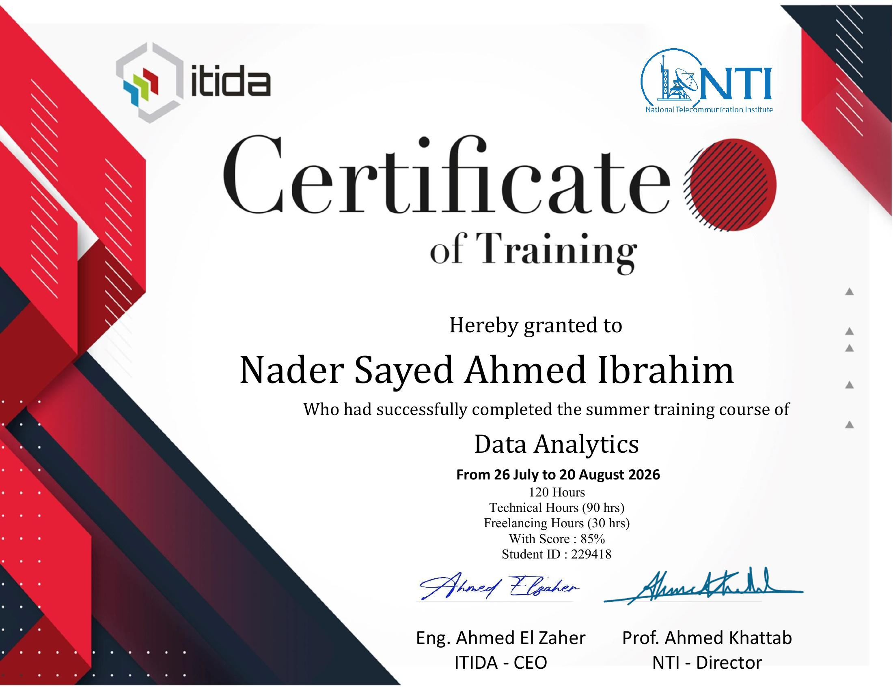
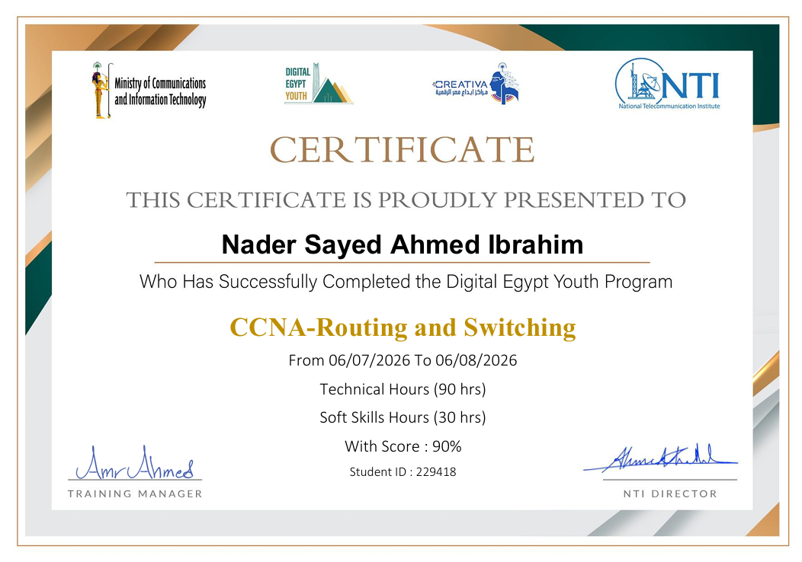

<!-- HEADER BANNER -->

  
  

  

  

---
# 👨‍💻 About Me

## Nader Sayed

**Data Analyst · Future Data Engineer**
**3rd-Year Computer & Artificial Intelligence Student**

**Faculty of Computers & AI, South Valley University, Egypt**

  

---

I enjoy turning raw data into clear decisions, from cleaning it and querying it with SQL to modeling it with DAX and presenting it in interactive Power BI dashboards. I also have a networking foundation (CCNA training), and my long-term direction is Data Engineering.

- 🎓 **Degree / Field:** Computers & Artificial Intelligence (3rd year), Faculty of Computers & AI, South Valley University
- 🏆 **Achievements:** Built 2+ interactive Power BI dashboards (Superstore Sales, Hotel Bookings) and completed 240 hours of certified training (Data Analytics with ITIDA & NTI, plus CCNA with Digital Egypt Youth)
- 🎯 **Focus Areas:** Data Analysis, Data Cleaning, SQL, Power BI & DAX, Dashboard Design
- 📬 **Contact:** nadersayedmnsa@gmail.com
-  WhatsApp: <a href="https://wa.me/201145009592" target="_blank">Chat on WhatsApp</a>
<!-- SOCIAL / PROFILE BADGES -->

---
## 🌐 Socials

  
  
  
  
  

---
## 🚀 Featured Projects

<table>
  <tr>
    <td width="33%" valign="top">
      <h3>📊 Project 1: Superstore Sales Analytics</h3>
      
An end-to-end sales analytics project on the Superstore dataset. I cleaned the data, prepared business KPIs, analyzed sales and profit, and built an interactive Power BI dashboard.

      

        
        
        
        
      

    </td>
    <td width="33%" valign="top">
      <h3>🏨 Project 2: Hotel Booking Dashboard</h3>
      
An interactive Power BI analysis of hotel bookings and cancellations, with KPIs, slicers and visual comparisons focused on bookings and performance.

      

        
        
        
      

    </td>
    <td width="33%" valign="top">
      <h3>🧹 Project 3: Excel Data Cleaning Workflow</h3>
      
A practical workflow for removing duplicates, handling blanks, standardizing values and validating fields, so datasets are clean and ready for analysis.

      

        
        
        
      

    </td>
  </tr>
</table>

  

---

## Tech Stack

**Data & Analytics**

  
  
  
  

**Languages**

  
  

**Tools & Networking**

  
  
  
  

---

## GitHub Stats

  

---

## 💻 Spent My Time

  

---
<!-- ============================================================
     CERTIFICATIONS & PROFESSIONAL LEARNING  |  paste into README.md
     Certificate files are read from the  certificates/  folder of this repo.
     ============================================================ -->

  
<!-- ─────────────── DASHBOARD COUNTERS ─────────────── -->

  
<!-- ─────────────── QUICK NAVIGATION BUTTONS ─────────────── -->

 

---

<!-- ═══════════════════════ 1. DATA ANALYTICS ═══════════════════════ -->

### 📊 Data Analytics

<table>
<tr>

<td align="center" width="50%">
 
<b>Data Analytics (Summer Training)</b> 
Jul – Aug 2026 · 120 hrs · Score 85% 
 

</td>

</tr>
</table>

 

<!-- ═══════════════════════ 2. NETWORKING ═══════════════════════ -->

### 🌐 Networking

<table>
<tr>

<td align="center" width="50%">
 
<b>CCNA: Routing and Switching</b> 
Jul – Aug 2026 · 120 hrs · Score 90% 
 

</td>

</tr>
</table>

 

<!-- ============================================================
     HOW TO ADD A NEW CERTIFICATE
     1. Upload the image to the  certificates/  folder (no spaces in the file name)
     2. Copy this block inside any <tr> ... </tr>
     3. Replace FILE-NAME and the title

<td align="center" width="50%">
 
<b>Certificate Title</b> 
 

</td>

     Then update the CERTIFICATES / TRAINING HOURS counters above.
     (The numbers inside header.svg/certificates-banner.svg are static: 2 / 2 / 240 / 2+)
     ============================================================ -->

---

### 📜 VERIFIED LEARNING PORTFOLIO

  

---

### 🌟 Continuous Learning • Practical Skills • Verified Knowledge

---

## Currently Exploring

* 🗄️ Advanced SQL
* 🏛️ Databases
* 🐍 Python for Data
* 🔄 ETL / ELT
* 🏢 Data Warehouses
* 🛠️ Data Pipelines
  

---

<h2 align="center">⭐ Submit Your Rating &amp; Feedback</h2>

  Enjoyed my work? Pick a star rating below. Your email app opens with the rating already filled in, 
  and your message goes straight to my inbox.

<table>
  <tr>
    <th align="center">Rating</th>
    <th align="center">Click to rate</th>
  </tr>
  <tr>
    <td align="center">⭐⭐⭐⭐⭐</td>
    <td align="center"></td>
  </tr>
  <tr>
    <td align="center">⭐⭐⭐⭐</td>
    <td align="center"></td>
  </tr>
  <tr>
    <td align="center">⭐⭐⭐</td>
    <td align="center"></td>
  </tr>
  <tr>
    <td align="center">⭐⭐</td>
    <td align="center"></td>
  </tr>
  <tr>
    <td align="center">⭐</td>
    <td align="center"></td>
  </tr>
</table>

 

---

  

---
# ⭐ Support

**If you find my work useful, consider giving it a ⭐.**

Your feedback, suggestions, and contributions are welcome.

  <b>🧹 Clean Data • 🗄️ Query with SQL • 📊 Build Dashboards • 🚀 Share Insights</b>

  Made with ❤️ for learning, experimentation, and continuous improvement.

---

## What I'm Looking For

I'm actively looking for **Data Analysis**, **Power BI / Business Intelligence** and **entry-level data** opportunities (internships included) where I can contribute to real-world analytics, learn from experienced analysts, and grow toward Data Engineering.

**If you'd like to collaborate, discuss an opportunity, or just connect, feel free to reach out.**

---

  

---

### Thanks for visiting my profile!

**If you like my work, consider giving a ⭐ to the repositories you find useful.**

 

  

